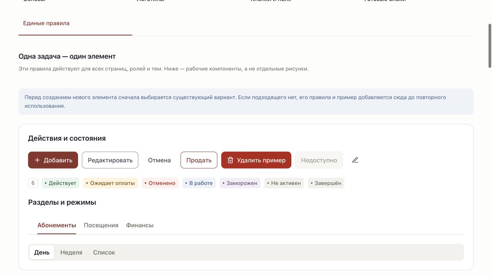
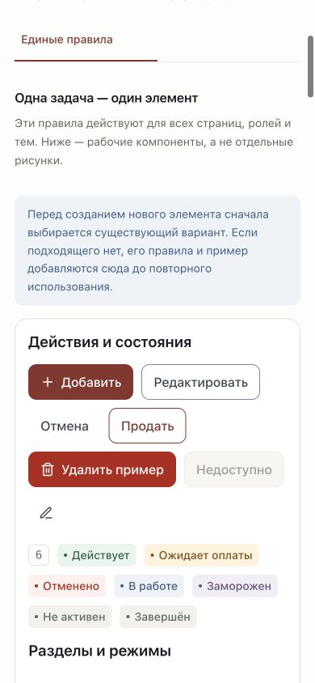

# Аудит единого интерфейса — 11–12 ноября 2026

## Результат

Общие элементы приложения и стайлгайда используют единый контракт оформления и поведения. Астрон, Графит и Контраст меняют палитру, а не геометрию и доступ к действиям. Изменения локальные, без commit/push и публикации. Исходные системы и их API не открывались; действия в браузере выполнялись с вымышленными данными прототипа в памяти.

## Единые паттерны

- Кнопки: основные, вторичные, текстовые, акцентные, опасные и с иконкой; размеры, отступы, фокус, отключённое и выбранное состояния.
- Поля, выпадающие списки и поиск: размеры, рамки, очистка, подписи и клавиатура. Крупный поиск ресепшена остаётся зарегистрированным специальным инструментом.
- Статусы и обратная связь: явная семантика полных значений. «Не активен» и «Не оплачено» не становятся зелёными из-за совпадения части слова.
- Вкладки и сегментированные режимы: общие компоненты с клавиатурой. Карточка клиента и расписание используют их напрямую.
- Панели, пустые состояния, сообщения, счётчики и показатели: общие отступы, скругления и типографика. Главные ролей используют общий Stats.
- Удаление записей/сообщений/занятий, отмена занятия и снятие записи/резерва: общий ConfirmDialog. Проверка роли и применение изменений остаются в доменных обработчиках.

## Исправленные ошибки

1. Стили страниц больше не перебивают общие компоненты: прежние стили изолированы в нижнем CSS-слое, контракт подключён к обеим сборкам. Стайлгайд использует базовые стили рабочих компонентов.
2. Escape в подсказках клиента закрывает список, оставляя окно занятия открытым. Вкладки имеют общую обработку стрелок, Home и End.
3. Длинная отметка «Не просмотрены» не обрезается в узкой колонке диалогов: фильтр использует Select.
4. Кнопка по умолчанию не отправляет форму; отправка заметки тренера задана явно.
5. На небольшом ноутбуке сведения и счёт клиента перестраиваются на полные строки, сохраняя размер текста и доступность действий.
6. Вложенные окна могли оставить заблокированную прокрутку после подтверждения удаления. Общий счётчик блокировок восстанавливает исходное значение после последнего окна при любом порядке закрытия.

## Правила дальнейшей работы

[Единая система интерфейса](ui-system.md) и AGENTS.md задают процесс: повторное использование, именованные общие варианты, регистрация нового назначения и рабочий пример одновременно с кодом. Реестр содержит 13 семейств правил и учитывает 47 экспортируемых компонентов, включая инфраструктурные провайдеры.

`pnpm test:ui` включён в CI. Проверяются реестр, семантика статусов, метрики, подключение стилей, отсутствие отдельных native select, подписи кнопок с иконками, запрет inline-оформления общих действий и полей, полное нахождение остальных CSS в нижних слоях и очистка блокировки вложенных окон. Автопроверка не заменяет визуальную оценку нового паттерна.

## Проверка и границы

- Все 12 команд: theme, search, workspace, schedule, staff, messages, catalog, registration, checkout, cash, crm, ui; TypeScript и production build.
- 57 целей: 44 рабочих раздела с доступной представительной ролью, главные 10 ролей, клиент, сотрудник и каталог разделов. На 1280×720 и 390×844, в трёх темах: 342 представления.
- Ещё 32 представления восьми основных целей на 1024×768 и 320×780 в Астроне и Контрасте.
- В матрице не обнаружены горизонтальное переполнение страницы, нарушения проверяемых размеров общих кнопок/полей/статусов/панелей и выход кнопок за границы панелей. Данные: [component-audit.json](audit-evidence-2026-11-11/component-audit.json).
- Визуально просмотрены клиентская база/карточка, продажа, касса, сообщения, расписание и тепловая карта, главная операционного директора. Проверены клавиатурные вкладки, редактирование клиента, отмена/подтверждение удаления записи и сообщения, отмена занятия, Escape в поиске и восстановление прокрутки вложенных окон.
- В стайлгайде проверены рабочие образцы, переключатель с клавиатуры, подтверждение и мобильные сегменты 44 px. Финальная проверка консоли не выявила ошибок.

Это покрытие страниц и общих паттернов, а не перебор всех комбинаций прав, данных и бизнес-состояний. Профильные тесты проверяют бизнес-ограничения отдельно. Новых зависимостей и платных библиотек нет.

## Примеры

