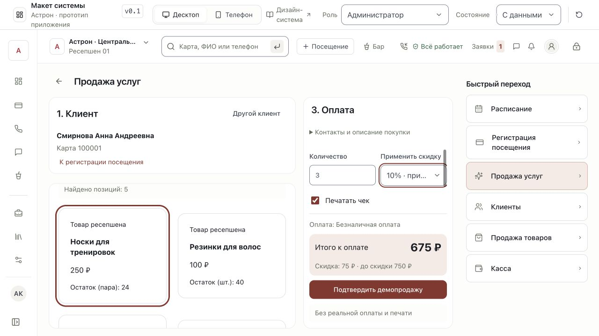
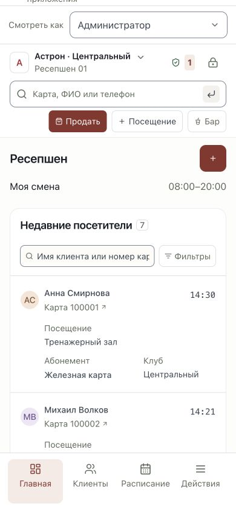

# Исправления по UX/UI-аудиту — 9 ноября 2026

Пользователь разрешил исправить все замечания, кроме F2, и отправить весь накопленный набор в GitHub. Исходный аудит и снимки «до» сохранены в `ux-ui-logic-audit-2026-11-09.md` и папке `audit-evidence-2026-11-09`.

| Пункт | Результат |
|---|---|
| F1 | Календарь использует текущий рабочий клуб. Выбор клуба в его фильтре синхронизирует левую панель/рабочую зону. Предпочтения календаря разделены по сотруднику и клубу. |
| F2 | **Исключён пользователем.** Черновики продажи и сообщения по-прежнему локальны для открытого модуля; хранения между разделами и предупреждения об уходе не добавлено. |
| F3 | Рабочие переходы создают историю браузера; параметры представления заменяют текущую запись. Назад/Вперёд восстанавливают страницу и клиентский контекст перехода. Это не сохранение черновиков F2. |
| F4 | На широком экране каталог и компактная оплата рядом. Итог/подтверждение видны, длинные параметры прокручиваются внутри. На узком экране — три шага и возврат к покупке; подтверждение не перекрывается нижней навигацией. Поиск выбранного клиента раскрывается кнопкой «Другой клиент». Все пять способов оплаты доступны через общий Select. |
| F5 | Уплотнена мобильная шапка, смена сворачивается в отдельную строку. Уникальность и сортировка доступны в фильтрах. Шрифт и области основных действий не уменьшались ради плотности. |
| F6 | Рабочая зона: Escape закрывает список и возвращает фокус; стрелки/Home/End управляют вариантами, Tab закрывает список. Добавлены listbox/option, aria-controls и состояние выбора. |
| F7 | Панель расписания переносится на узком экране; образцы скруглений в стайлгайде — сетка 2×2. Исправление не скрывает переполнение принудительным overflow-x:hidden. |
| F8 | В «Абонементах» и счётчиках только карты прохода. Прокат и купленные разовые услуги — в отдельном списке «Дополнительные услуги» во вкладке финансов. |
| F9 | Общие демочасы основаны на TODAY и московском времени. Новые посещения, продажи, кассовые движения, сообщения, заметки и логи не используют текущий день/час компьютера как дату операции. «Дней в клубе» считается на тот же демонстрационный день. Сброс данных сбрасывает демочасы. |
| F10 | В пустом состоянии клиентов — 0; при загрузке и ошибке числовой бейдж скрыт. |

## Проверка

- TypeScript, 11 предметных проверок и production build успешны. В test:registration добавлены проверки общей даты, московского времени, прошедших дней и сброса часов; test:messages поддерживает импорт общего модуля часов.
- Production-сборка: все 42 раздела проверены на 1280×720, 1024×650, 390×844 и 320×800; горизонтального переполнения и ошибок приложения не найдено. Четыре категории стайлгайда на 320 px также без переполнения.
- Воспроизведён исходный F1: сначала открыт Центральный, затем выбран Парк. В календаре и слева Парк; обратное переключение через фильтр также синхронизирует контекст.
- Назад/Вперёд браузера возвращают между главной и клиентами. Внутренний возврат из кассы сохраняет исходного клиента продажи, но **не восстанавливает товар/количество** — F2 сознательно не исправлен.
- На телефоне подтверждение оплаты доступно для нажатия над нижней навигацией. Проверена смена способа оплаты и завершение демопродажи.
- В production-сборке 3 пары носков по 250 ₽ со скидкой 10% дали 675 ₽; эта сумма появилась в кассе за 06.11.2026 в 14:35. Реальных платежей нет.
- В мобильных фильтрах включена уникальность: 5 посетителей; сброс вернул 7. Сортировка доступна в том же окне.
- Escape закрыл список рабочих мест и вернул фокус на исходную кнопку. На 320 px список помещается в экран.
- У Анны во вкладке «Абонементы» три карты; полотенце вынесено в финансы. Дней в клубе — 55. В пустом состоянии клиентов бейдж 0, в загрузке отсутствует.

## Снимки после исправлений

Перезагрузка по-прежнему восстанавливает демоданные; серверная авторизация, оборудование и API исходных систем не подключались. Новых зависимостей нет.
